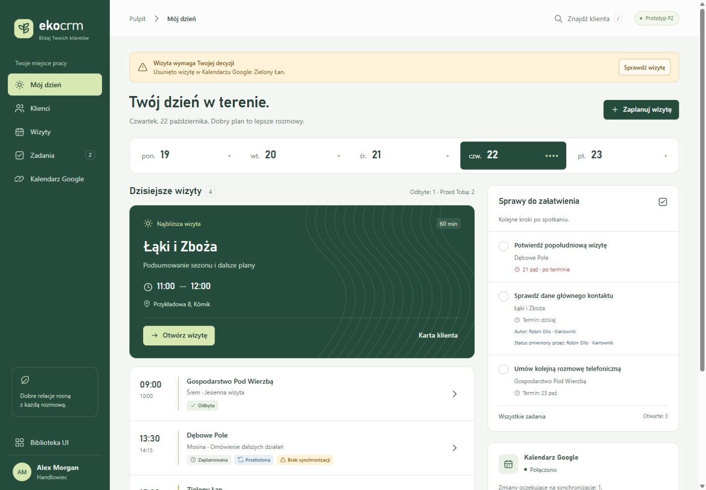

# Eko_CRM

<p align="center">
  
</p>

An internal CRM for one agricultural sales company. Each sales rep keeps their own customers —
mostly farmers — plans field visits that appear in their own Google Calendar, and records notes
and follow-up actions after each visit. Managers get a reliable count of visits held, moved and
cancelled, which replaces manual reporting.

The project is also **a working instantiation of [Ninefold](https://github.com/TanerCRB/NineFold)**
— an SDLC process for software development driven by AI agents (Spec-Driven Development +
Human-in-the-Loop). Every task goes from an Issue through acceptance criteria, an architecture
impact map, implementation, mutation testing and independent reviews, with three gates an agent
never crosses.

> **Status:** under development, no production environment. The foundations are built and proven
> (containers, migrations, logging, backup, release pipeline, frontend shell); login and the
> product features are next. Only synthetic data is used until the GDPR impact assessment allows
> otherwise — do not enter real customer data.

## What the application does

Scope, rules and requirement identifiers: [`docs/product/project-brief.md`](docs/product/project-brief.md).

| Role | What they do | What they see |
|---|---|---|
| Sales rep | Owns customers (about 200 each), plans and performs visits, writes notes, works through follow-ups; links a private Gmail account for the calendar only | Only their own customers, visits, notes and actions |
| Manager | Reassigns customers between reps, edits customer data, adds notes and actions and closes actions — always visibly attributed | Everything, including the team dashboard |
| Administrator | Creates, deactivates and assigns roles to accounts in the identity server | — |

Main areas of the MVP:

- **Customers** (`CUS-`) — contacts with notes and one primary, Polish postal code and NIP
  checksum, duplicate warnings within the viewer's scope, archive with visible consequences,
  reassignment that keeps history.
- **Visits and Google Calendar** (`VIS-`) — visits synchronised to the rep's own calendar; a visit
  has exactly one state (*planned*, *held*, *cancelled*, *awaiting decision*) and independent flags
  (*moved*, *not synchronised*). A visit deleted in Google never goes unnoticed: it waits for the
  owner's decision. Losing Google access changes no visit state.
- **Notes and follow-ups** (`NOT-`, `ACT-`) — notes on visits in any state, follow-up actions born
  from a note, valid status transitions, overdue and reminders.
- **Access** (`ACC-`) — own accounts in Keycloak, never dependent on Google; reps see only their
  own data, enforced on the server.
- **Dashboard** (`DSH-`, after the MVP) — visits held, planned, moved and cancelled per rep and
  period.

The interface is Polish, because the users are Polish sales reps; code, documentation and the API
surface are English.

## Progress

- [`docs/PLAN.md`](docs/PLAN.md) — the task register. Most of **EKO-1 (Foundations)** is done;
  still open are the Keycloak configuration (EKO-1-12), shipping its events off the server
  (EKO-1-09) and the production server with a proven restore (EKO-1-08). **EKO-2 (Access)** —
  login and roles — comes next.
- [`docs/architecture/capabilities.md`](docs/architecture/capabilities.md) — what is **proven by a
  test**, kept separate from what has merely been decided.
- [`docs/architecture/decisions/`](docs/architecture/decisions/) — six accepted decisions:

| ADR | Decides |
|---|---|
| [ADR-0001](docs/architecture/decisions/ADR-0001-application-stack.md) | Application stack and layer rules |
| [ADR-0002](docs/architecture/decisions/ADR-0002-database-and-migrations.md) | PostgreSQL 18, SQLAlchemy 2, Alembic |
| [ADR-0003](docs/architecture/decisions/ADR-0003-identity-and-access.md) | Keycloak, roles, deactivation, password reset |
| [ADR-0004](docs/architecture/decisions/ADR-0004-deployment-and-recovery.md) | Containers, HTTPS, secrets, daily off-server backup and restore |
| [ADR-0005](docs/architecture/decisions/ADR-0005-personal-data.md) | Personal data: where it lives, what is logged, archiving vs. erasure |
| [ADR-0006](docs/architecture/decisions/ADR-0006-google-calendar.md) | Google Calendar: OAuth, token storage, change detection, retries |

Built so far, each with tests and recorded mutations:

- a composition of nine services in the development profile — `proxy` (Caddy), `frontend`,
  `backend`, `migrate`, `worker`, `keycloak`, `postgres`, `backup`, `mailcatcher`;
- migrations safe against concurrent runs, older and newer schemas and stalls;
- architecture controls in CI (layer check, lint bans, API compatibility with the previous release);
- bounded, personal-data-free logs with one correlation identifier per request;
- an encrypted backup to an append-only destination (against a test double so far);
- a release pipeline that publishes images by digest (first release `v0.1.1`);
- the frontend shell and shared components taken from prototype P2.

## Design prototypes

Three independent, clickable prototypes were made from the brief before any product code, each
without looking at the others. **P2 was chosen**: its shell, design tokens and components carry
into `frontend/`.

| Prototype | Direction | Open |
|---|---|---|
| [P1](docs/prototype/P1/README.md) | Rapeseed-yellow accent, day agenda on hour rails | `py -m http.server 8417 --directory docs/prototype/P1` |
| [**P2**](docs/prototype/P2/README.md) | Forest green, quiet field lines; the rep's day: next visit, agenda, follow-ups | `cd docs/prototype/P2 && npm start` (port 4174), or open `index.html` |
| [P3](docs/prototype/P3/README.md) | Week board, Polish typefaces, signal red only for decisions | `py docs/prototype/P3/serve.py 8419` |

P2 runs without a build or network, with a fixed demo clock and three personas (two reps and a
manager). Next to the demo it holds the material for production:
[`DESIGN.md`](docs/prototype/P2/DESIGN.md) (direction and critique),
[`HANDOFF.md`](docs/prototype/P2/HANDOFF.md) (component inventory and the state rules to keep),
[`REQUIREMENTS.md`](docs/prototype/P2/REQUIREMENTS.md) (coverage and gaps),
[`SCENARIOS.md`](docs/prototype/P2/SCENARIOS.md) (a repeatable walkthrough) and
[`VALIDATION.md`](docs/prototype/P2/VALIDATION.md). The prototypes are design artifacts, not product
code: role behaviour is simulated in the browser and proves no capability.

## Tech stack

| Layer | Technologies |
|---|---|
| Backend (`backend/`) | Python 3.12, FastAPI, Pydantic v2, SQLAlchemy 2, Alembic, uv |
| Frontend (`frontend/`) | React 19, TypeScript (strict), Vite, Vitest, pnpm |
| Data and identity | PostgreSQL 18, Keycloak |
| Runtime | Docker Compose, Caddy as the HTTPS proxy, images published to GHCR by digest |
| Tests | pytest (unit, static and runtime against the running composition), Vitest + Testing Library |

## Getting started

After cloning:

```bash
git config core.hooksPath .githooks     # the pre-push guard on main
node tools/sync-agents.mjs              # copies agents/ into .claude/agents/
```

### Run the development profile

Needs Docker Engine with Compose v2, and bash (Git Bash on Windows) for the first line.

```bash
bash scripts/dev-env.sh ../eko-dev.env   # once: an untracked file of synthetic values, outside the checkout
docker compose --env-file ../eko-dev.env --profile dev up --build --wait
```

The application answers at `https://localhost:8443/` (certificate from Caddy's internal CA), its
health route at `https://localhost:8443/api/health`. Stop with
`docker compose --env-file ../eko-dev.env --profile dev down`; add `-v` to delete the data volumes.
Without `--profile dev` the same file is the shared-environment composition (no mail catcher).

The environment file also names this checkout's Compose project and backend image tag, so each
worktree needs its own file (for example `../eko-dev-<identifier>.env`) and two worktrees run side
by side without sharing containers, volumes or images. `COMPOSE_PROJECT_NAME` is required: without
it the composition refuses to start, so a shared environment sets it once in its own environment
file, and its database volume (`<project>_pgdata`) does not change with the directory a release is
unpacked in. If `postgres` reports that a volume's first initialisation did not complete, run
`down -v` and start again.

### Tests and lint

Python 3.12 with [uv](https://docs.astral.sh/uv/), Node.js 22.12+ with pnpm (`corepack enable`
activates the version pinned in `frontend/package.json`), Docker for the runtime tests.

```bash
( cd backend && uv sync --locked && uv run pytest )
( cd backend && uv run pytest -m "runtime or previous_release" tests/runtime )   # needs Docker
( cd frontend && pnpm install --frozen-lockfile && pnpm lint && pnpm test && pnpm build )
```

CI ([`.github/workflows/ci.yml`](.github/workflows/ci.yml)) runs the same on every pull request,
plus the layer check and the runtime tests against the built images.

## Process: Ninefold

[Ninefold](https://github.com/TanerCRB/NineFold) is a portable starter kit for an AI-agent SDLC
process. Its core principle: **a role that produces something never evaluates it**, and every
handoff between roles puts a fresh set of eyes on the result.

- **Roles** ([`agents/`](agents/)) — ten definitions, synced to `.claude/agents/` with
  `node tools/sync-agents.mjs`:
  - producing: `product-owner`, `analyst`, `architect`, `developer-backend`,
    `developer-frontend`, `developer-infrastructure`;
  - evaluating: `invariant-guardian`, `reviewer`, `security-auditor`, `qa`.
- **Team contract** ([`TEAM-CONTRACT.md`](TEAM-CONTRACT.md)) — who does what, gates, hard stops;
  takes precedence over the role files.
- **State machine and labels** ([`process/sdlc-flow.md`](process/sdlc-flow.md),
  [`process/labels.json`](process/labels.json)), Issue and PR templates, process checks in
  [`scripts/`](scripts/), a pre-push hook.
- **Commands** — `/task #N` drives one task from Issue to PR, `/task-status #N` is a read-only
  report ([`.claude/commands/`](.claude/commands/)).
- **Calibration** ([`calibration/`](calibration/)) — how to check that an evaluating role actually
  evaluates before you start trusting it.

### Three human gates

1. **Scope and architecture** — before any code is written.
2. **Merge into `main`** — a code PR (`Refs #N`) moves the Issue to evidence; it does not close it.
3. **Merge of the documentation PR** (`Closes #N`) — raises the status in `docs/PLAN.md` and in the
   capability register.

The `waiting-on-human` label marks all three: `is:open label:waiting-on-human` shows everything
waiting on the human.

### Proof, not claims

An acceptance criterion has an observable carrier, an opposite, and a named mutation that must kill
it. QA removes the mechanism and records whether the test actually failed. An entry in the
capability register points to a specific test and the kind of evidence. Deviations are recorded,
not hidden: [`docs/architecture/exception-register.md`](docs/architecture/exception-register.md).

The reasoning behind the approach: [`FrameworkDoc.md`](FrameworkDoc.md),
[`CASE-STUDY.md`](CASE-STUDY.md) and [`process/`](process/). Start working in this repository with
[`CLAUDE.md`](CLAUDE.md) and [`TEAM-CONTRACT.md`](TEAM-CONTRACT.md).

## Conventions

- English: code, comments, commits, Issues, PRs, documentation, the API surface. The UI copy is
  Polish.
- A task that writes code works in its own `git worktree` (`../Eko_CRM-<identifier>`), not in the
  main checkout.
- Tests live in `backend/tests/` and `frontend/tests/`, never next to the code. An existing test
  that starts failing because of a change is never weakened or removed.
- Only synthetic data, in tests, fixtures, evidence and prototypes.

## License

Copyright © 2026 Mariusz Miziołek.

Eko_CRM is licensed under the
**[PolyForm Noncommercial License 1.0.0](https://polyformproject.org/licenses/noncommercial/1.0.0)**
— full text in [`LICENSE`](LICENSE).

- **Noncommercial use is free** — learning, research, personal and hobby projects, nonprofit
  organizations, educational and public institutions, under the terms of the license.
- **Commercial use requires the author's prior written permission** (a separate commercial
  license). This covers, among others, use within a company, in services delivered to clients, and
  in products sold or offered for a fee. For a commercial license, contact the author via
  [GitHub](https://github.com/TanerCRB).

When redistributing, keep the license text and the `Required Notice:` lines from `LICENSE`.

**Files originating from Ninefold.** The [Ninefold](https://github.com/TanerCRB/NineFold)
framework is licensed under the Apache License 2.0
([`LICENSE-APACHE-2.0`](LICENSE-APACHE-2.0), [`NOTICE`](NOTICE)). The files based on it
(`FrameworkDoc.md`, `CASE-STUDY.md`, `UPGRADING.md`, `TEAM-CONTRACT.md`, `agents/`, `process/`,
`scripts/`, `tools/`, `calibration/`, `.claude/commands/`) originate from that project; to use the
process itself — commercially as well — use the original Ninefold repository under its license.
